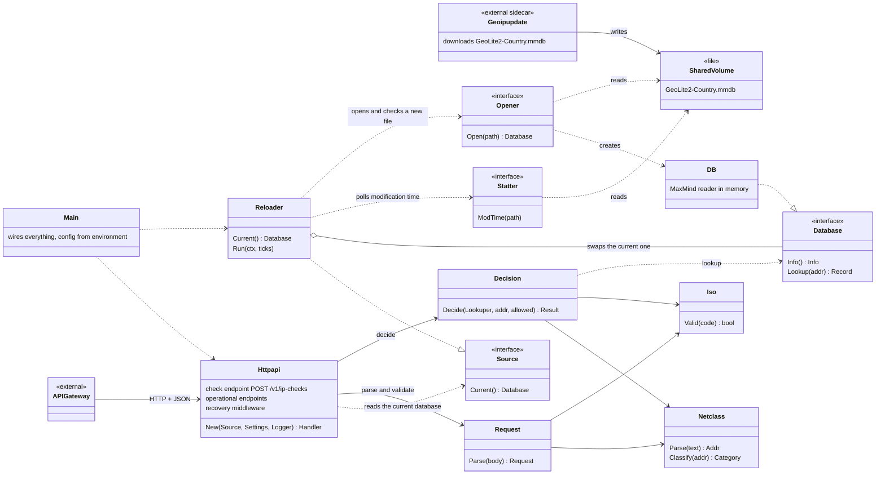
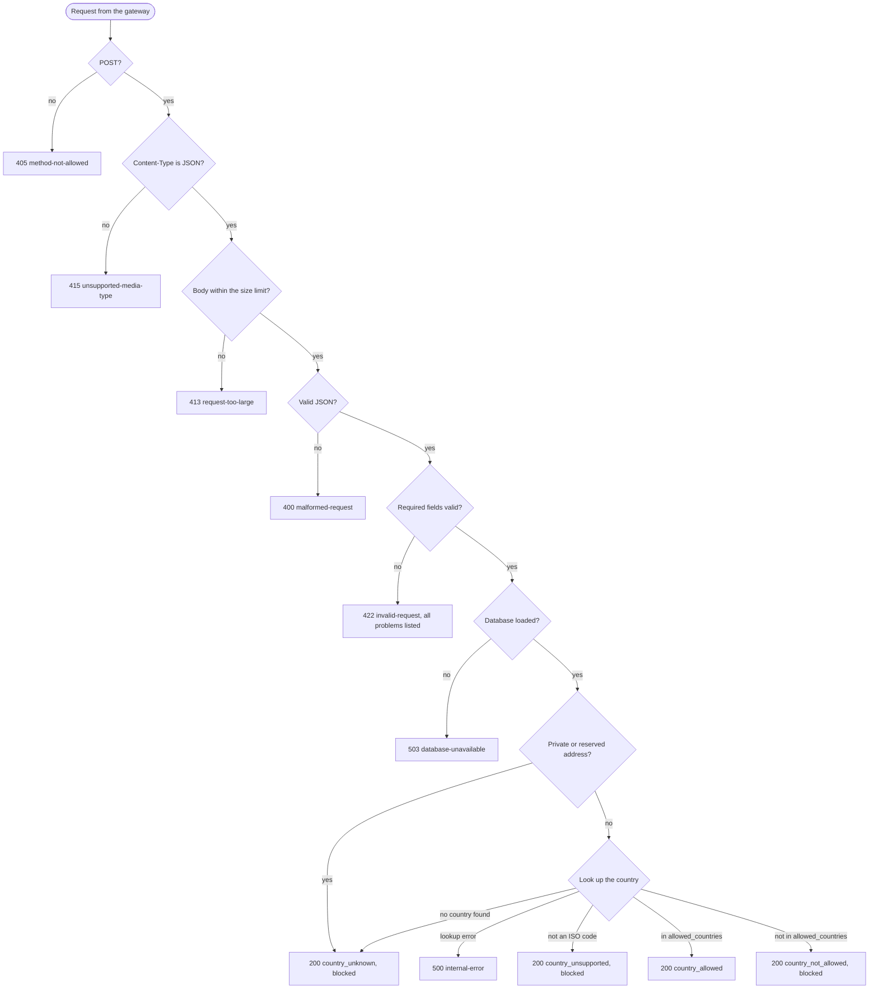

# geo-ip-allowlist-service

A small Go HTTP service that answers one question: **is this IP address inside one of the allowed countries?**

- The API gateway calls it before a UI login, with the client IP and the list of allowed countries.
- It looks the IP up in a MaxMind GeoLite2 Country database, held in memory.
- It answers `200` with `allowed: true` or `false` and a machine-readable `reason`. A blocked IP is a successful check, not an error.
- An IP with no known country (private, reserved, not in the database) is blocked: the service never fails open.
- The IP is never logged and the `ip_address` value is never echoed in a response. One exception: an invalid entry in `allowed_countries` is quoted back in the 422 error text.

Where it sits: `user -> API gateway -> geo-ip-allowlist-service`. A separate update container downloads the database; the service only reads it ([docs/deployment.md](docs/deployment.md)).

## System overview

How the service is composed. Boxes are Go packages (under `internal/` and `cmd/`), drawn like classes. The boxes marked `<<interface>>` are the small interfaces that tests replace with fakes.



- `Httpapi` is the only part that speaks HTTP. `Request` and `Decision` have no HTTP in them, so they are tested alone.
- The database is read through the small `Database` interface. `Reloader` holds the current one and swaps it when a new, checked file appears; requests in flight are never dropped.
- The update container is outside the service: it only writes the file. The service reads it and never holds the MaxMind credentials.

## How a request is handled

What happens to one `POST /v1/ip-checks`. Each check stops at the first failure, and every 4xx and 5xx is the gateway's "error" state. A panic anywhere becomes `500 internal-error` through the recovery middleware.



The reasons and the exact bodies are in [docs/api.md](docs/api.md).

## API specification

`POST /v1/ip-checks` with `Content-Type: application/json`.

| Request field | Required | Rule |
|---|---|---|
| `ip_address` | yes | IPv4 or IPv6 text address |
| `allowed_countries` | yes | non-empty array of ISO 3166-1 alpha-2 codes (`gb` is read as `GB`) |
| `session_id` | no | string, at most 128 characters; echoed back when valid |
| `requested_at` | no | RFC 3339 timestamp; only logged |

Unknown fields are ignored. A bad `session_id` or `requested_at` is ignored with a warning, not rejected.

| Response field | Meaning |
|---|---|
| `allowed` | `true` only when `reason` is `country_allowed` |
| `reason` | `country_allowed`, `country_not_allowed`, `country_unknown` (no country found), `country_unsupported` (country code is not ISO alpha-2, today `XK`) |
| `detail` | sentence for people; do not parse it |
| `country` | `{"iso_code","name"}`, or `null` for `country_unknown` |
| `session_id`, `warnings` | only when present |

Request:

```json
{
  "ip_address": "81.2.69.160",
  "allowed_countries": [
    "GB",
    "DE"
  ],
  "session_id": "3f1b5c9e-7a4d-4a64-9d2e-6d7a1f0c8b11",
  "requested_at": "2026-11-08T17:00:00Z"
}
```

Response `200`:

```json
{
  "allowed": true,
  "reason": "country_allowed",
  "detail": "The IP address is located in GB (United Kingdom), which is in allowed_countries.",
  "country": {
    "iso_code": "GB",
    "name": "United Kingdom"
  },
  "session_id": "3f1b5c9e-7a4d-4a64-9d2e-6d7a1f0c8b11"
}
```

A blocked IP is still `200`, with `allowed: false` and the cause in `reason` and `detail`. The same request with `"allowed_countries": ["DE"]` returns:

```json
{
  "allowed": false,
  "reason": "country_not_allowed",
  "detail": "The IP address is located in GB (United Kingdom), which is not in allowed_countries, so it is blocked.",
  "country": {
    "iso_code": "GB",
    "name": "United Kingdom"
  },
  "session_id": "3f1b5c9e-7a4d-4a64-9d2e-6d7a1f0c8b11"
}
```

With a private address (`"ip_address": "10.0.0.1"`) no country can be found, so `country` is `null`:

```json
{
  "allowed": false,
  "reason": "country_unknown",
  "detail": "The IP address is in a private range and has no associated country, so it is blocked.",
  "country": null
}
```

Every 4xx and 5xx the service writes is an [RFC 9457](https://www.rfc-editor.org/rfc/rfc9457) `application/problem+json` document. For the gateway, any 4xx or 5xx means "error". The `type` is `PROBLEM_BASE_URL` (default `https://geo-service.example/problems/`) plus the name below.

| Status | Problem type | When | Example that causes it |
|---|---|---|---|
| 400 | `malformed-request` | body is not valid JSON | body `{bad` |
| 405 | `method-not-allowed` | not `POST` on the check; not `GET`/`HEAD` on `/livez`, `/readyz`, `/version`, `/metrics` | `GET /v1/ip-checks` |
| 413 | `request-too-large` | body above `MAX_REQUEST_BODY_BYTES` (default 16384) | a 16385-byte body |
| 415 | `unsupported-media-type` | `Content-Type` missing or not `application/json` | `curl -d '{}'` with no header |
| 422 | `invalid-request` | JSON is not an object, a required field is missing or invalid, or the list is empty; all problems are listed | `{"ip_address":"nope","allowed_countries":["USA"]}` |
| 500 | `internal-error` | lookup error or panic; no internals in the body | cannot be triggered on purpose |
| 503 | `database-unavailable` | valid check, or `/readyz`, while no database is loaded | start with a missing database file |

All problem bodies have `type`, `title`, `status`, `detail`; only 422 adds `invalid_params`. The 422 example above answers:

```json
{
  "type": "https://geo-service.example/problems/invalid-request",
  "title": "Invalid request",
  "status": 422,
  "detail": "The request body is missing required fields or has invalid values.",
  "invalid_params": [
    {
      "pointer": "/ip_address",
      "reason": "ip_address must be a valid IPv4 or IPv6 address."
    },
    {
      "pointer": "/allowed_countries/0",
      "reason": "'USA' is not an ISO 3166-1 alpha-2 country code."
    }
  ]
}
```

The exact body of every problem is in [docs/api.md](docs/api.md). Other endpoints: `GET /livez`, `GET /readyz`, `GET /version`, `GET /metrics`.

## Quickstart

Needs Go 1.26 and `curl`. No MaxMind account is needed: it uses the synthetic test database in `testdata/`.

```
GEOIP_DATABASE_PATH=testdata/GeoIP2-Country-Test.mmdb LISTEN_ADDR=127.0.0.1:8080 go run ./cmd/geoip-service
```

In a second terminal:

```
curl -s -X POST -H 'Content-Type: application/json' \
  -d '{"ip_address":"81.2.69.160","allowed_countries":["GB"]}' http://127.0.0.1:8080/v1/ip-checks
```

You should see `"allowed":true,"reason":"country_allowed"`. In the test database `81.2.69.160` is in GB; the other test addresses are in [testdata/README.md](testdata/README.md).

## Install and deploy to test

Details, settings and credentials: [docs/deployment.md](docs/deployment.md). What to install for each option (Docker, `kubectl`, a local `kind` cluster): [requirements](docs/deployment.md#requirements).

- **Laptop (the Go binary):** `go build -o bin/geoip-service ./cmd/geoip-service`, then run it with the variables above. This is [Workflow A](#workflow-a-run-the-go-binary) and is all a reviewer needs.
- **Docker (optional):** `docker build -t geo-ip-allowlist-service:dev .`; the image holds no database, so mount one ([Workflow B](#workflow-b-optional-docker-and-kubernetes), step B1). With Compose and no credentials: `docker compose -f docker-compose.test.yml up --build`.
- **Kubernetes (optional):** `deploy/kubernetes/geoip-service.yaml` (Deployment with an update sidecar, Service, NetworkPolicy). It needs a MaxMind licence key for the sidecar; see the deployment document.

## Workflow: build, run and verify

For a reviewer or a coding agent. There are two workflows. Each step has a command, the expected result and how to tell it worked. Run the commands from the repository root. Neither needs credentials.

| | Workflow A | Workflow B |
|---|---|---|
| What | Run the Go binary itself | Run the container image and read the Kubernetes manifest |
| Status | **Start here; enough to judge the service** | **Optional** |
| Needs | Go 1.26, `git`, `curl` | Docker or Podman for B1; nothing extra for B2 (a cluster and `kubectl` only to deploy, see [requirements](docs/deployment.md#requirements)) |

## Workflow A: run the Go binary

**A1. Clone.**
```
git clone https://github.com/massimilianoBastia/geo-ip-allowlist-service.git && cd geo-ip-allowlist-service
```
Worked if `ls go.mod Dockerfile api/openapi.yaml testdata/GeoIP2-Country-Test.mmdb` lists all four files.

**A2. Build.**
```
go build -o bin/geoip-service ./cmd/geoip-service
```
No output; exit code 0; `bin/geoip-service` exists. (If your Go is older than 1.26, `go` downloads the toolchain named in `go.mod`, which needs network.)

**A3. Test.**
```
gofmt -l . ; go vet ./... ; go test -race -cover ./...
```
`gofmt -l .` and `go vet` print nothing. `go test` prints ten lines starting with `ok` and no `FAIL`. (`-race` needs a C compiler; without one, use `go test -cover ./...`.) No test uses the network or a real GeoLite2 file.

**A4. Run with the test database** (in the background; the second line waits until it is ready).
```
GEOIP_DATABASE_PATH=testdata/GeoIP2-Country-Test.mmdb LISTEN_ADDR=127.0.0.1:8080 ./bin/geoip-service > /tmp/geoip.log 2>&1 &
for _ in $(seq 50); do curl -sf http://127.0.0.1:8080/livez >/dev/null && break; sleep 0.2; done; echo up
```
Prints `up`. `/tmp/geoip.log` holds JSON lines, including `"msg":"database loaded"` and a WARN `sanity lookups are off` (expected: no sanity pairs are configured).

**A5. Check readiness.**
```
curl -s -w '\nHTTP %{http_code}\n' http://127.0.0.1:8080/readyz
```
Expect `HTTP 200` and `{"database_built_at":"2026-10-22T18:52:57Z","database_type":"GeoIP2-Country","status":"ready"}`.

**A6. Call the API.** Four calls; the expected status and key fields are in the comment.
```
# allowed -> HTTP 200, "allowed":true,"reason":"country_allowed"
curl -s -w '\nHTTP %{http_code}\n' -X POST -H 'Content-Type: application/json' -d '{"ip_address":"81.2.69.160","allowed_countries":["GB","DE"]}' http://127.0.0.1:8080/v1/ip-checks

# blocked -> HTTP 200, "allowed":false,"reason":"country_not_allowed"
curl -s -w '\nHTTP %{http_code}\n' -X POST -H 'Content-Type: application/json' -d '{"ip_address":"81.2.69.160","allowed_countries":["DE"]}' http://127.0.0.1:8080/v1/ip-checks

# private IP -> HTTP 200, "allowed":false,"reason":"country_unknown","country":null
curl -s -w '\nHTTP %{http_code}\n' -X POST -H 'Content-Type: application/json' -d '{"ip_address":"10.0.0.1","allowed_countries":["GB"]}' http://127.0.0.1:8080/v1/ip-checks

# error -> HTTP 422, application/problem+json, two entries in invalid_params
curl -s -w '\nHTTP %{http_code}\n' -X POST -H 'Content-Type: application/json' -d '{"ip_address":"nope","allowed_countries":["USA"]}' http://127.0.0.1:8080/v1/ip-checks
```

**A7. Stop the service.**
```
pkill -x geoip-service
```
Worked if `curl -s http://127.0.0.1:8080/livez` now prints nothing and exits with code 7 (connection refused). The log ends with `"msg":"server stopped"`.

## Workflow B (optional): Docker and Kubernetes

Do Workflow A first, and finish its step A7 so port 8080 is free.

**B1. Build and run the image** (use `podman` in place of `docker` if you prefer). The image holds no database, so the test file is mounted read-only.
```
docker build -t geo-ip-allowlist-service:dev .
docker run -d --name geoip-try -p 127.0.0.1:8080:8080 -v "$PWD/testdata:/data:ro,z" -e GEOIP_DATABASE_PATH=/data/GeoIP2-Country-Test.mmdb geo-ip-allowlist-service:dev
sleep 2; curl -s -w '\nHTTP %{http_code}\n' http://127.0.0.1:8080/readyz
docker rm -f geoip-try
```
The build ends with a "Successfully tagged" or "writing image" line. `/readyz` gives `HTTP 200`, the same body as step A5. (The `z` lets SELinux hosts read the folder and is ignored elsewhere.)

**B2. Read the manifest** (no cluster needed).
```
grep -n '^kind:' deploy/kubernetes/geoip-service.yaml
grep -nE 'image:|readOnlyRootFilesystem|secretName' deploy/kubernetes/geoip-service.yaml
```
The first lists the objects (Deployment, Service, NetworkPolicy). The second shows two `image:` lines (the service image, a placeholder name; the MaxMind update image), two `readOnlyRootFilesystem: true`, and the Secret name the sidecar reads. Details of each object: [docs/deployment.md](docs/deployment.md).

Deploying to a cluster needs `kubectl`, a cluster and a MaxMind licence key. It is described in [docs/deployment.md](docs/deployment.md), not here.

## Assumptions

Short reasons; the full list with sources is in [docs/api-design-notes.md](docs/api-design-notes.md).

- **A blocked IP is `200`, not an error.** The gateway has three states: allowed, not allowed, error.
- **No country means blocked** (`country_unknown`), and there is no fallback to `registered_country`: failing open would let anyone bypass the restriction.
- **`XK` (Kosovo) can never be allowed.** The contract is ISO 3166-1 alpha-2 and `XK` is not in it.
- **`POST` with a JSON body**, so the IP stays out of access-log URLs.
- **An invalid country code is a 422, not ignored**, because silently dropping it would block that country's users with no trace.
- **An IPv6 zone (`fe80::1%eth0`) is dropped, not rejected**; it names a local interface, not a country.
- **The service starts without a database** and answers `503` until the first file arrives, so the sidecar has time to download it.
- **A bad or older database file is rejected** and the old data kept, with an ERROR log.
- **Plain HTTP inside the cluster**, limited by a NetworkPolicy to the gateway namespace. The IP the gateway sends is trusted.
- **`/metrics` uses the standard library**, not the Prometheus client: it has three series and no new dependency. Switch only for histograms or runtime metrics (notes, G69).
- **Very old data still answers.** Whether it should stop is an open business question (BQ2, [below](#open-questions-for-the-business-team)).

## Open questions for the business team

Not blocking: the service works with the defaults below. Reasons and sources: [docs/api-design-notes.md](docs/api-design-notes.md), section G (BQ2, BQ3) and section E.

| ID | Question | Who can answer | Default today |
|---|---|---|---|
| BQ2 | Should very old data ever stop the service from answering? What does the GeoLite2 licence require about update frequency and deleting outdated copies? | The MaxMind account holder and legal | Keep answering and show the age (`database_built_at` in `/readyz` and `/version`, `database_build_timestamp_seconds` in `/metrics`). The update container refreshes every 24 hours. |
| BQ3 | May end users see the `detail` texts? They are in English and name countries. | Product and the customer-facing team | `detail` is written for the gateway and for support, not for end users. |

Limits the business should know and accept (notes, section E): VPNs and proxies are not detected, and Kosovo (`XK`) can never be allowed because the contract is ISO 3166-1 alpha-2.

## For the gateway team

What the gateway needs to know. The full contract is [docs/api.md](docs/api.md) and [api/openapi.yaml](api/openapi.yaml); the reasons are in the notes (A3, A4, D1, E7, J4).

- **Three states.** `200` with `allowed: true`: let the user in. `200` with `allowed: false`: block. Any `4xx` or `5xx`: "error".
- **Switch on `reason`, never parse `detail`.** The four values are in [the API specification](#api-specification). Ignore `warnings` codes you do not know.
- **A warning is a hint, not a failure.** It tells you a part of the request was not used (for example a duplicate country); the decision is still valid.
- **Send the real client address as `ip_address`.** The service trusts it. A private, loopback or reserved address is answered `country_unknown` and blocked, so send the address of the user, not of a proxy.
- **`session_id`** (a UUID is recommended; any string of at most 128 characters is accepted) is echoed back and written to every log line of the request, so you can correlate. It is optional.
- **`503` means "retry later".** It happens until the first database file is loaded. `/readyz` is `200` when the service can answer.
- **Limits.** Request body at most 16384 bytes; the service gives up on a request after 10 seconds. Plain HTTP inside the cluster.
- **Address.** The Kubernetes Service is `geoip-service`, port 80. The NetworkPolicy admits only the namespace named `api-gateway`, which is a **placeholder** in the manifest ([docs/deployment.md](docs/deployment.md#what-you-must-change-first)).

Open for the gateway team (not defined by this service):
- What should the gateway do in the "error" state: let the user in or block? The design only says that `4xx`/`5xx` is the client's error state; the policy is the gateway's.
- What is the real name of the gateway namespace, for the NetworkPolicy?
- Which URL should be `PROBLEM_BASE_URL`? The default `https://geo-service.example/problems/` is a placeholder.

## What is built and what is only designed

- **Built and tested:** the check endpoint, `/livez`, `/readyz`, `/version`, `/metrics`, reload of the database file, and the Dockerfile (built and run with Podman).
- **Designed only:** gRPC (design in the notes, section F2), VPN and proxy detection (not planned; known limitation).
- **Run:** `docker-compose.test.yml`, and `docker-compose.yml` with a real MaxMind account (the real GeoLite2 file was downloaded and answered), both with Docker Compose v5.6.0 against Podman's socket.
- **Run on a local cluster:** the Kubernetes manifest on `kind`, with a placeholder Secret and with a real one (real download, sanity check pass and fail, `kubectl port-forward` checks, NetworkPolicy enforced). See [docs/deployment.md](docs/deployment.md#run-on-kubernetes).
- **Not tested:** the unit tests never use the real GeoLite2 file (by design); the daily update after the first download; clusters other than `kind`; plain `docker` (everything was run with Podman).

## Use of AI

Claude Code was used under the developer's direction. See [docs/ai-usage.md](docs/ai-usage.md) for the usage notes, accepted fixes, and edited prompt/session logs.

## Licence and data

- The code is under the MIT licence ([LICENSE](LICENSE)), as declared in `api/openapi.yaml`.
- `testdata/GeoIP2-Country-Test.mmdb` is MaxMind's synthetic test data, under Apache-2.0 / MIT ([testdata/README.md](testdata/README.md)).
- The real `GeoLite2-Country.mmdb` is under MaxMind's GeoLite2 licence. It is **never committed** and the service never downloads it. Only the update container does, with your own MaxMind account.
- MaxMind credentials are only ever read-only mounted files in the update container: never environment values, never in the image, never in the repository. Only `secrets/*.example` placeholders are committed.

## Where to find what

| Topic | Authority |
|---|---|
| Decisions and reasons | [docs/api-design-notes.md](docs/api-design-notes.md) |
| Machine-readable contract | [api/openapi.yaml](api/openapi.yaml) |
| Problem types | [docs/problems.md](docs/problems.md) |
| API detail | [docs/api.md](docs/api.md) |
| Running and deploying | [docs/deployment.md](docs/deployment.md) |
