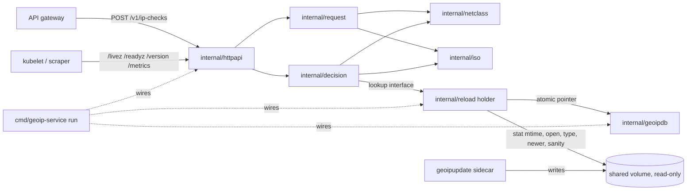
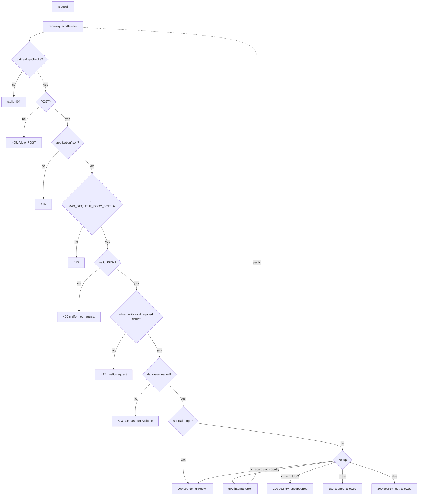
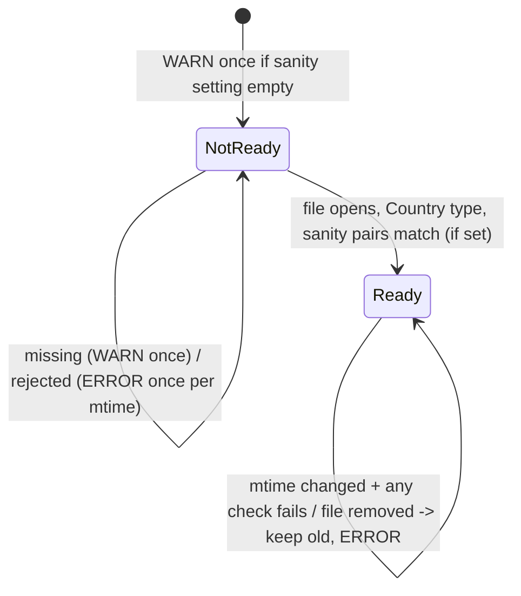
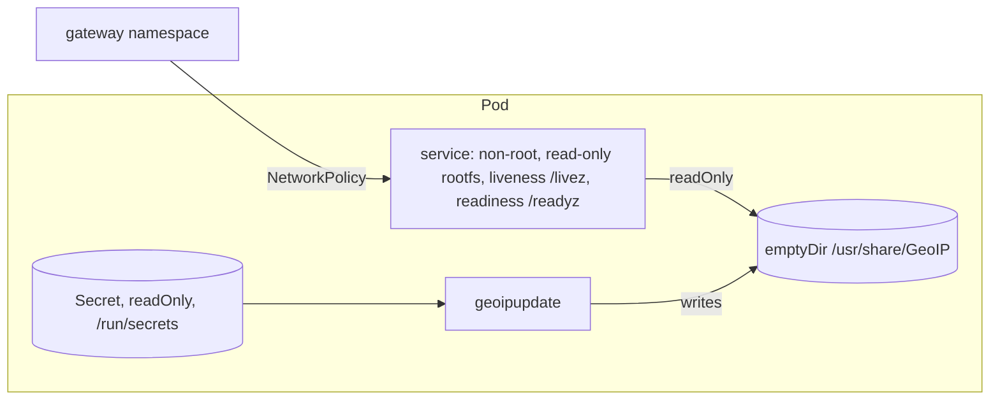

# Plan: geo-ip-allowlist-service

> **APPROVED** by the developer (revision 3, after two grillz reviews). Steps are done one at a time, in the order below.
> Approval scope: this plan and all proposed items G2 to G47 in `docs/decision-log.md`, as written there (source PLAN-APPROVAL in its appendix). Exception recorded at approval: the sanity-lookups setting must never make startup fail; if it is empty or unset the service logs a WARN and starts. G1, the ISO check date, was supplied by the developer later in the session and is recorded in G1 of the notes.
> A = approved by the developer with a question ID. P = proposed by the designer and approved at plan approval (listed in `docs/decision-log.md`, section G).

## Rephrased request

Build a small, stateless Go service for the API gateway. It answers `POST /v1/ip-checks`: given `ip_address` and the customer's `allowed_countries`, is the IP in one of those countries according to MaxMind GeoLite2? The gateway uses the answer to block UI logins from countries the customer has not approved.

- Only the IP is checked. VPNs are out of scope.
- An IP with no resolvable country is blocked, with a clear reason (agreed with the stakeholder).
- The service stores nothing.
- Go and the standard library, plus one approved dependency (`maxminddb-golang/v2`), using the Go server-project layout.
- The GeoLite2 file is never committed. A sidecar downloads it; the service reads, checks and swaps it in.
- Required: consistent handling of bad input, IPv6, private and loopback addresses, IPs missing from the data; logging; error handling; operational endpoints; fresh data.
- Order of work: design, review, tests, code.
- Core: the service, in-process reload, `/version`, the Dockerfile and the Kubernetes manifest.
- Optional, cut first: `/metrics`, then `docker-compose.yml`.
- gRPC is designed but not built.

## Summary

- **Check endpoint.** `POST /v1/ip-checks` returns 200 with `allowed`, a stable `reason`, a human-readable `detail` and `country` (or `null`).
- **Errors.** RFC 9457 problem responses: 400, 405, 413, 415, 422 (lists every problem). No loaded data: 503. Unexpected failure or panic: 500 with no internals. Any 4xx/5xx is the client's "error" state.
- **Blocking.** Private, reserved and unknown addresses are always blocked. `registered_country` is never used.
- **Startup and reload.** Starts without data, reports not ready. Polls the file's modification time. A new file is swapped in only if it opens, is the Country database, is newer, and passes the developer's sanity lookups (when configured).
- **Logs.** JSON, never contain the IP, carry `session_id`.
- **Operational endpoints.** `/livez`; `/readyz` (includes `database_built_at`); `/version` (`{version, database_built_at}`).
- **Deployment.** Dockerfile and Kubernetes manifest with the update sidecar. Optionally Compose and `/metrics`.
- **Documents.** Design notes (with the question-and-answer log), then OpenAPI contract. Where they disagree, the earlier one wins.

## Layout (Go server project, A: GR1)

```
cmd/geoip-service/main.go        wiring only: main() calls run(...)
cmd/geoip-service/main_test.go   unit tests of run (lifecycle)
internal/config/                 settings from the environment
internal/iso/                    constant list of the 249 ISO codes (test written first)
internal/netclass/               IP parsing/normalisation, address category, truncated-address log type
internal/request/                body decoding and validation, optional fields, warnings (uses netclass)
internal/decision/               pure decision; no HTTP; gets a parsed netip.Addr and the lookup interface
internal/geoipdb/                database file -> in-memory reader, metadata, lookup behind a small interface
internal/reload/                 mtime poll, verify, atomic swap, goroutine
internal/httpapi/                handlers, RFC 9457 problems, /livez /readyz /version (/metrics), body limit, recovery middleware
tests/scenarios/                 acceptance scenarios with testdata/GeoIP2-Country-Test.mmdb (existing directory)
api/openapi.yaml                 contract
deploy/kubernetes/geoip-service.yaml   manifest (path P)
deploy/kubernetes/secret.example.yaml  example Secret, placeholders only, never applied (G71)
Dockerfile, docker-compose.yml, docker-compose.test.yml, secrets/*.example, README.md, LICENSE, docs/api.md, docs/deployment.md
```

Unit tests sit next to their code. Scenario tests live only in `tests/scenarios/`; they assemble the real `geoipdb`, `reload` and `httpapi` around the test database (importing `internal/` from `tests/` is allowed, both are inside the module root).

## Components

| # | Package | Responsibility | Depends on |
|---|---|---|---|
| 1 | `internal/config` | Reads and validates environment settings. Errors name the variable. | injected `getenv` |
| 2 | `internal/iso` | The 249-code constant and a membership check. Pure. | none |
| 3 | `internal/netclass` | Parses an IP (zone dropped; IPv4-mapped unmapped). Classifies `private`, `loopback`, `link_local`, `unspecified`, `reserved`, `public`. Log type renders only the prefix (/24 IPv4, /48 IPv6). Pure. | none |
| 4 | `internal/request` | Body bytes to: malformed; invalid (ordered `invalid_params`); valid (address, ordered code set, optional fields, warnings, unknown field names, logging details). Pure. | 2, 3 |
| 5 | `internal/decision` | From a parsed address and code set: `allowed`, `reason`, `country`, `detail`, `address_category`. | 2, 3, lookup interface |
| 6 | `internal/geoipdb` | Reads file into memory (`OpenBytes`), checks Country type, exposes type and build time, looks up `{found, iso_code, name}`. | maxminddb-golang/v2 |
| 7 | `internal/reload` | Atomic pointer to current DB. Polls mtime, verifies (open, type, newer, sanity), swaps or keeps old, logs which. | 6 via opener interface, stat, clock/ticker, logger |
| 8 | `internal/httpapi` | Pipeline, problem writer, body limit, recovery middleware, `/livez`, `/readyz`, `/version`, optional `/metrics`, per-request logging. | 4, 5, 7 via small interfaces, logger |
| 9 | `cmd/geoip-service` | `run(...)` builds and connects everything, starts poller and server, graceful shutdown. `main()` only calls `run`. | all |
| 10 | Deployment | Dockerfile and Kubernetes manifest (core). Compose (optional). | 9 |

## Key decisions

| ID | Decision | Alternatives | Reason | Status |
|---|---|---|---|---|
| KD1 | `POST /v1/ip-checks`, JSON body | GET; `/v1/check` | RFC 9110: input in body, nothing stored; keeps IPs out of URL logs; `/v1` per Google AIP | A (E2) |
| KD2 | Response `{allowed, reason, detail, country, session_id?, warnings?}`; `allowed` true only for `country_allowed` | reason only | Client has three states: allowed, not allowed, error | A (E2, E2c) |
| KD3 | Four reasons. No country: `country_unknown`, `country: null`. Non-ISO code: `country_unsupported` with the country object | a code per cause | Check completed, nothing to match; failing open would allow bypass | A (E2a, E2b) |
| KD4 | No fallback to `registered_country`/`represented_country` | fallback | Could let a restricted user through | A (E2a) |
| KD5 | One dependency `maxminddb-golang/v2`; decode only `country.iso_code`, `names.en` | geoip2-golang; own reader | stdlib cannot read the format; in-process, single file; few dependencies. Speed unverified until S-006 | A (E1) |
| KD6 | Embedded constant of 249 codes, test first; validates requests and detects unsupported countries | a rule | Exact, cannot drift | A (E4-b, L1) |
| KD7 | Upper-case (ASCII-only: P), validate, dedupe, match. No trim. Invalid entries 422, all listed. Duplicates warn. Empty list 422 | trim; drop invalid | Silent drop would block a country's users with no trace | A (E4, W1-W4, E2e-4) |
| KD8 | RFC 9457, seven types, `type` = base URL + name. Only `invalid-request` has `invalid_params: [{pointer, reason}]`, `ip_address` first then countries by index. Invalid JSON 400; non-object JSON 422; wrong Content-Type 415; too large 413; not POST 405 + `Allow: POST`; no data 503; unexpected 500 | custom body | Standard; match by pointer | A (R1, P1-P4, R2, R2-a, E3) |
| KD9 | Lenient `session_id`, `requested_at`: bad value ignored with a warning. `warnings` open list of `{code, detail, pointer?}`, omitted when empty | 422 | Do not change the decision | A (E2d) |
| KD10 | Body cap 16,384 bytes, configurable. 16,384 ok, 16,385 gets 413 | 1 MiB | Bounds the list | A (R1) |
| KD11 | Reload polls mtime only. New file must open, be Country, be newer, pass sanity. Else keep old, log ERROR | fsnotify; SIGHUP | stdlib only, easy to fake | A (E6) |
| KD12 | Sanity lookups: a developer-supplied setting, every load incl. first, no default. Empty: other checks still run, one WARN "sanity lookups are off". Name and format P | built-in pairs | Test DB and real DB differ | A (GR5); format P |
| KD13 | `OpenBytes` into memory, atomic pointer swap, never close a reader possibly in use | mmap + refcount | Unmapping a file being read is unsafe | P |
| KD14 | Start without data; `/readyz` and checks 503 until first load; `/livez` always 200 | exit at startup | Sidecar downloads after start | P |
| KD15 | Env var settings; JSON `slog` to stdout | flags | Container-friendly | P |
| KD16 | Plain HTTP in cluster + NetworkPolicy | TLS/mTLS; mesh | Fits scope | P |
| KD17 | Official `ghcr.io/maxmind/geoipupdate` sidecar with `_FILE` vars; service mounts volume read-only | service downloads | CLAUDE.md | A (CLAUDE.md); image and frequency P |
| KD18 | gRPC designed only (notes F2) | build it | Scope decision | A (E8) |
| KD19 | Core: reload, `/version`, Dockerfile, Kubernetes. Cut first: `/metrics`, then Compose | | Scope decision | A (E8, GR ops) |
| KD20 | `go.mod`: module path, `go 1.26.0`, `toolchain go1.26.10` | `go 1.26.10`; `go 1.26` | Developer's decision | A (E10, GR2); indirect handling P |
| KD21 | `/metrics` Prometheus text format, stdlib only | client library | No new dependency | P |
| KD22 | Server-project layout; scenarios in `tests/scenarios/` | flat | CLAUDE.md, developer's decision | A (GR1) |
| KD23 | `/livez` replaces `/healthz`. `/readyz` stays, includes the DB build date. `/version` returns `{"version","database_built_at"}` | `/healthz` | Kubernetes deprecates healthz | A (GR ops). P: version injection; `/version` with no data omits the field; `/readyz` field name aligned |
| KD24 | Recovery middleware: panic gives 500 `internal-error`, no internals; ERROR log with stack and `session_id` if known, omitted if not | net/http recovery | net/http recovery is outside slog and has no problem body | A (GR ops); panic after headers P |
| KD25 | IP never logged or returned. Truncated-address type is only a safety net (/24, /48) | | Privacy | A (GR logging); exact string P |

## Edge cases (each has a test; u = unit, s = scenario)

| ID | Case | Expected | Covered by |
|---|---|---|---|
| EC-01 | Not valid JSON: empty, `not json`, `{"a":1} {}` | 400 `malformed-request`, "The request body is not valid JSON." (P) | S-009 u, S-014 u |
| EC-02 | Valid JSON not an object: `[]`, `null`, `"x"`, `42` | 422, `[{"pointer":"","reason":"The request body must be a JSON object."}]` (wording P) | S-009 u, S-014 u, S-017 s |
| EC-03 | Content-Type missing, `text/plain`, `application/xml` | 415. `application/json; charset=utf-8` accepted (P) | S-014 u |
| EC-04 | Method not POST | 405, `Allow: POST` | S-014 u |
| EC-05 | Body 16,384 vs 16,385 bytes | 200 vs 413 | S-014 u, S-017 s |
| EC-06 | `ip_address` missing, null, misspelled | 422 `/ip_address` "ip_address is required." | S-009 u, S-017 s |
| EC-07 | `ip_address` not a string | 422 "ip_address must be a string." | S-009 u |
| EC-08 | `ip_address` invalid: `999.1.1.1`, `010.0.0.1`, ` 1.2.3.4`, `""` | 422 "ip_address must be a valid IPv4 or IPv6 address." (P, G48) | S-008 u, S-009 u |
| EC-09 | `allowed_countries` missing, null, not an array | 422 `/allowed_countries` | S-009 u |
| EC-10 | `allowed_countries` `[]` | 422 "allowed_countries must contain at least one country code." (wording P) | S-009 u, S-014 u, S-017 s |
| EC-11 | Non-string entries `[1,"GB",null]` | 422 `/allowed_countries/0` and `/2` | S-009 u |
| EC-12 | Non-ISO entries: `USA`, `XK`, `UK`, ` DE`, `1`, `ıt` | 422, one item per entry, quoted as sent | S-009 u, S-017 s |
| EC-13 | Several errors | One 422, ordered | S-009 u, S-017 s |
| EC-14 | Lowercase `gb` | Treated as `GB` | S-009 u, S-017 s |
| EC-15 | Duplicate entries | 200 with a warning per repeat | S-009 u, S-017 s |
| EC-16 | IPv6 `2001:218::1` | JP, Japan | S-011 u, S-017 s |
| EC-17 | IPv4-mapped IPv6; IPv6 with a zone (`fe80::1%eth0`) | Unmapped, treated as IPv4; zone dropped, looked up as `fe80::1`: 200 `country_unknown`, link-local text (A16) | S-008 u, S-009 u, S-017 s |
| EC-18-22 | Private, loopback, link-local, unspecified, reserved | `country_unknown`, matching detail and category | S-008 u, S-010 u, S-017 s |
| EC-23 | IP not in DB (`8.8.8.8` in test DB) | `country_unknown`, `public_unmapped` | S-010 u, S-011 u, S-017 s |
| EC-24 | Record without country (`214.1.1.1`, `2a02:d500::1`) | Same as EC-23 | S-010 u, S-011 u, S-017 s |
| EC-25 | `registered_country` differs (`2.125.160.216`, `["FR"]`) | `country_not_allowed`, GB | S-011 u, S-017 s |
| EC-26 | Non-ISO code `XK` | `country_unsupported`, `{XK, Kosovo}`; fake lookup | S-010 u, S-014 u |
| EC-27 | `session_id` edge values | Echoed / warning / omitted | S-009 u, S-014 u |
| EC-28 | `requested_at` | Valid is logged; invalid warns; never returned | S-009 u, S-014 u |
| EC-29 | Unknown fields | Ignored; only the count logged at DEBUG | S-009 u, S-014 u |
| EC-30 | No DB at startup | `/readyz` and checks 503; `/livez` 200; `/version` 200 `{"version":"..."}` without `database_built_at` (P) | S-012 u, S-014 u, S-015 u, S-016 u |
| EC-31 | New file corrupt, wrong type, older, or fails sanity | Old data kept; one ERROR per mtime | S-012 u |
| EC-32 | Swap during in-flight requests | No failures, no data race | S-012 u |
| EC-33 | File removed after loading | Old data kept; ERROR | S-012 u |
| EC-34 | Invalid configuration | Startup stops; error names the variable | S-013 u, S-016 u |
| EC-35 | Lookup error | 500 | S-014 u |
| EC-36 | Unknown path | stdlib 404 (P) | S-014 u |
| EC-37 | Full IP in logs or responses | Never | S-014 u, S-017 s |
| EC-38 | SIGTERM with request in flight | Request completes; `run` returns nil | S-016 u |
| EC-39 | `ıt` | 422 (must not become `IT`) | S-009 u |
| EC-40 | Handler panics | 500, no internals; ERROR with stack, `session_id` only if known | S-023 u |
| EC-41 | Truncated-address rendering | `81.2.69.160` to `81.2.69.0/24`; `2001:218::1` to `2001:218::/48` | S-008 u |
| EC-42 | Empty sanity setting | Other checks still run; one WARN | S-012 u |

## Diagrams









## Assumptions

- This round produces plan and design text only. No code step starts until the developer approves.
- Commit process (CLAUDE.md): each code step is three commits: skeleton (stubs return deliberately wrong values), red tests, implementation. Gate: `gofmt -l .`, `go vet ./...`, `go test -race -cover ./...`. No test uses the network and no test opens a socket: `cmd/geoip-service/main_test.go` passes an in-memory listener (built on `net.Pipe`) through `deps.listener`, and its HTTP client dials that listener.
- Test-only steps S-005 and S-006 test the library and data, not our code, so there is no skeleton. S-005: helper and README check in one commit (red: generated block missing), then the `-update` output in a second commit (green). S-006: one commit plus the measured numbers recorded in notes D7.
- S-005, S-006 and S-011 share one helper, `internal/geoipdb/testdb_test.go` (path `../../testdata/GeoIP2-Country-Test.mmdb` and an opened reader). Scenarios list fixture addresses as literals, documented by the README table.
- Business questions are BQx. Review items are GR1-GR7, "GR ops", "GR logging".
- `maxminddb-golang/v2` v2.9.0 API (`OpenBytes`, `Lookup(netip.Addr)`, `Decode`, `Prefix`, `Metadata`) is confirmed in S-005. If anything differs, stop and ask.
- Test values come from the JSON source of the test DB and are confirmed against the `.mmdb` in S-005. On any mismatch, stop and ask.

## Business questions

- **BQ2** Should very old data ever stop the service answering? What does the GeoLite2 licence require about update frequency and deleting old copies? Who: MaxMind account holder and legal. Default: keep answering; `/readyz` and `/version` show `database_built_at`; sidecar updates every 24 h. Blocking: no.
- **BQ3** May end users see the `detail` texts? Who: product and customer-facing team. Default: as written, for the gateway and support. Blocking: no.

## Steps

Order: documents (S-001, S-002); core (S-004 to S-016, S-023, S-017); core deployment (S-018, S-020); optional (S-019, then S-022). Cut from the end: S-022 first, then S-019. S-003 (agent brief) was dropped (G74 in `docs/decision-log.md`).

Each step is done in the order skeleton, failing tests, implementation (see `CLAUDE.md`). The expected values of each step are the tests in the repository and the edge cases above; the full per-step test text was removed from this plan once the steps were built.

| Step | What | Depends on |
|---|---|---|
| S-001 | Design notes: `docs/api-design-notes.md` | none |
| S-002 | Contract: `api/openapi.yaml` (OpenAPI 3.1) | S-001 |
| S-004 | Module settings and `main` placeholder | S-002 |
| S-005 | README check of the test database (test-only; `internal/geoipdb`) | S-004 |
| S-006 | Lookup benchmark (test-only; `internal/geoipdb`) | S-005 |
| S-007 | ISO list | S-004 |
| S-008 | Address parsing, classification, log guard | S-004 |
| S-009 | Request decoding | S-007, S-008 |
| S-010 | Decision | S-007, S-008 |
| S-011 | Database adapter | S-006 |
| S-012 | Reload | S-011 |
| S-013 | Settings | S-007, S-008 |
| S-014 | Check handler and problems | S-009, S-010, S-012 |
| S-015 | Operational endpoints | S-012 |
| S-023 | Recovery middleware | S-014 |
| S-016 | Wiring and lifecycle | S-013, S-014, S-015, S-023 |
| S-017 | Acceptance scenarios | S-016 |
| S-018 | Dockerfile (core) | S-016 |
| S-020 | Kubernetes manifest (core) | S-018 |
| S-019 | `docker-compose.yml` (optional; cut second) | S-018 |
| S-022 | `/metrics` (optional; cut first) | S-014, S-012 |
