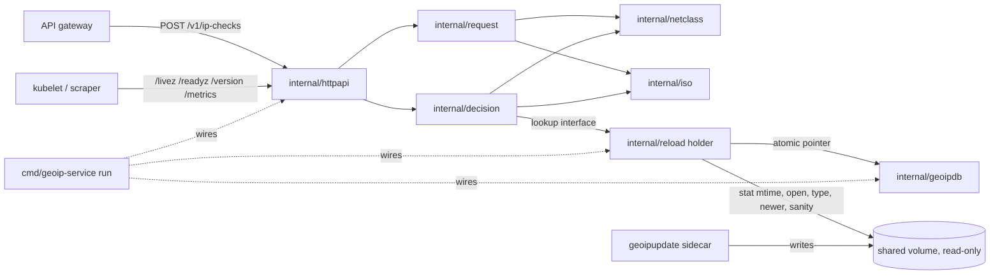
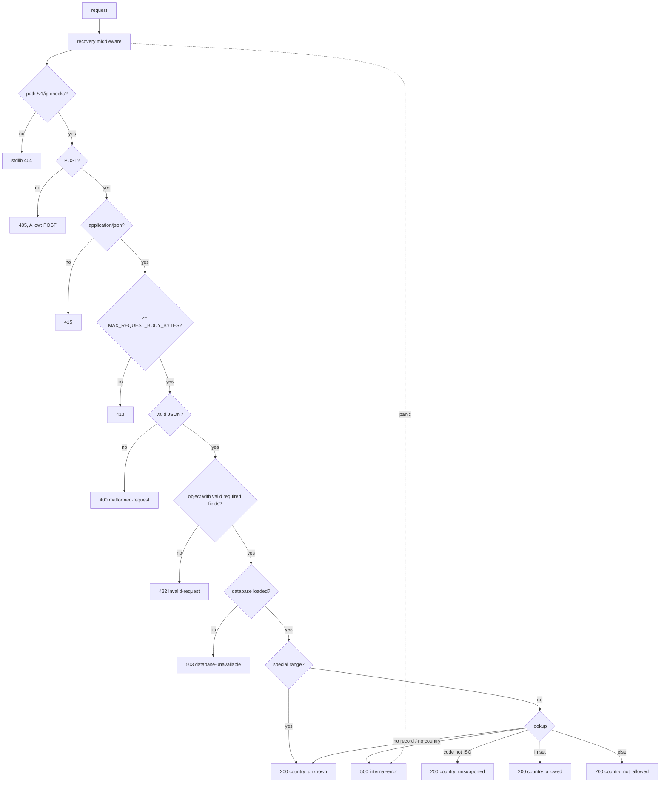
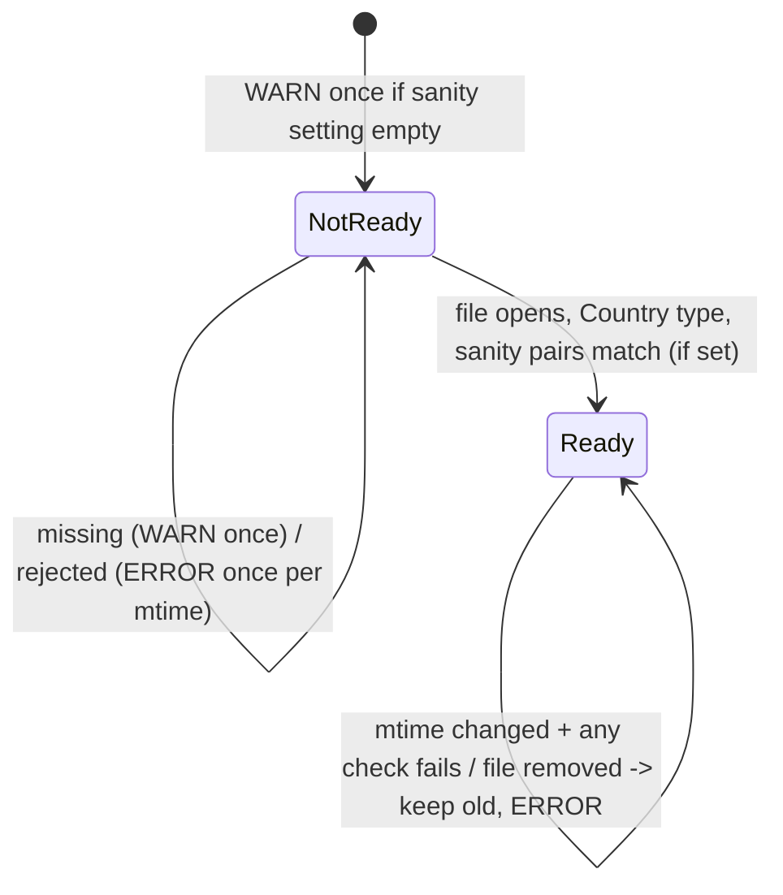
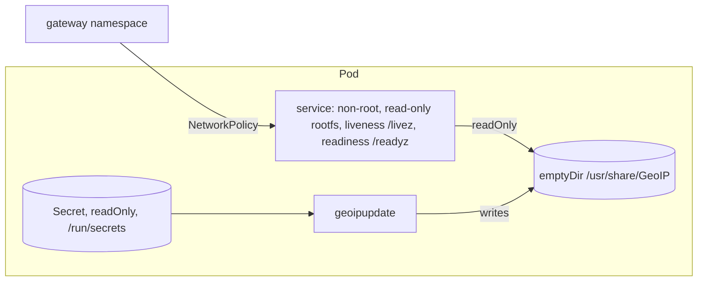

# Plan: geo-ip-allowlist-service

> **APPROVED** by the developer (revision 3, after two grillz reviews). Steps are done one at a time, in the order below.
> Approval scope: this plan and all proposed items G2 to G47 in `docs/api-design-notes.md`, as written there (source PLAN-APPROVAL in the notes appendix). Exception recorded at approval: the sanity-lookups setting must never make startup fail; if it is empty or unset the service logs a WARN and starts. G1, the ISO check date, was supplied by the developer later in the session and is recorded in G1 of the notes.
> A = approved by the developer with a question ID. P = proposed by the designer and approved at plan approval (listed in notes section G).

## Rephrased request

Build a small, stateless Go service for the API gateway. It answers `POST /v1/ip-checks`: given `ip_address` and the customer's `allowed_countries`, is the IP in one of those countries according to MaxMind GeoLite2? The gateway uses the answer to block UI logins from countries the customer has not approved.

- Only the IP is checked. VPNs are out of scope.
- An IP with no resolvable country is blocked, with a clear reason (agreed with the stakeholder).
- The service stores nothing.
- Go and the standard library, plus one approved dependency (`maxminddb-golang/v2`), using the Go server-project layout.
- The GeoLite2 file is never committed. A sidecar downloads it; the service reads, checks and swaps it in.
- Required: consistent handling of bad input, IPv6, private and loopback addresses, IPs missing from the data; logging; error handling; operational endpoints; fresh data.
- Order of work: design, review, tests, code, within 4 hours.
- Core: the service, in-process reload, `/version`, the Dockerfile and the Kubernetes manifest.
- Optional, cut first: `/metrics`, then `docker-compose.yml`.
- gRPC is designed but not built.

## Summary

- **Check endpoint.** `POST /v1/ip-checks` returns 200 with `allowed`, a stable `reason`, a human-readable `detail` and `country` (or `null`).
- **Errors.** RFC 9457 problem responses: 400, 405, 413, 415, 422 (lists every problem). No loaded data: 503. Unexpected failure or panic: 500 with no internals. Any 4xx/5xx is the client's "error" state.
- **Blocking.** Private, reserved and unknown addresses are always blocked. `registered_country` is never used.
- **Startup and reload.** Starts without data, reports not ready. Polls the file's modification time. A new file is swapped in only if it opens, is the Country database, is newer, and passes the developer's sanity lookups (when configured).
- **Logs.** JSON, never contain the IP, carry `session_id`.
- **Operational endpoints.** `/livez`; `/readyz` (includes `database_built_at`); `/version` (`{version, database_built_at}`).
- **Deployment.** Dockerfile and Kubernetes manifest with the update sidecar. Optionally Compose and `/metrics`.
- **Documents.** Design notes (with the question-and-answer log), then OpenAPI contract. Where they disagree, the earlier one wins.

## Layout (Go server project, A: GR1)

```
cmd/geoip-service/main.go        wiring only: main() calls run(...)
cmd/geoip-service/main_test.go   unit tests of run (lifecycle)
internal/config/                 settings from the environment
internal/iso/                    constant list of the 249 ISO codes (test written first)
internal/netclass/               IP parsing/normalisation, address category, truncated-address log type
internal/request/                body decoding and validation, optional fields, warnings (uses netclass)
internal/decision/               pure decision; no HTTP; gets a parsed netip.Addr and the lookup interface
internal/geoipdb/                database file -> in-memory reader, metadata, lookup behind a small interface
internal/reload/                 mtime poll, verify, atomic swap, goroutine
internal/httpapi/                handlers, RFC 9457 problems, /livez /readyz /version (/metrics), body limit, recovery middleware
tests/scenarios/                 acceptance scenarios with testdata/GeoIP2-Country-Test.mmdb (existing directory)
api/openapi.yaml                 contract
deploy/kubernetes/geoip-service.yaml   manifest (path P)
deploy/kubernetes/secret.example.yaml  example Secret, placeholders only, never applied (G71)
Dockerfile, docker-compose.yml, docker-compose.test.yml, secrets/*.example, README.md, LICENSE, docs/api.md, docs/deployment.md
```

Unit tests sit next to their code. Scenario tests live only in `tests/scenarios/`; they assemble the real `geoipdb`, `reload` and `httpapi` around the test database (importing `internal/` from `tests/` is allowed, both are inside the module root).

## Components

| # | Package | Responsibility | Depends on |
|---|---|---|---|
| 1 | `internal/config` | Reads and validates environment settings. Errors name the variable. | injected `getenv` |
| 2 | `internal/iso` | The 249-code constant and a membership check. Pure. | none |
| 3 | `internal/netclass` | Parses an IP (zone dropped; IPv4-mapped unmapped). Classifies `private`, `loopback`, `link_local`, `unspecified`, `reserved`, `public`. Log type renders only the prefix (/24 IPv4, /48 IPv6). Pure. | none |
| 4 | `internal/request` | Body bytes to: malformed; invalid (ordered `invalid_params`); valid (address, ordered code set, optional fields, warnings, unknown field names, logging details). Pure. | 2, 3 |
| 5 | `internal/decision` | From a parsed address and code set: `allowed`, `reason`, `country`, `detail`, `address_category`. | 2, 3, lookup interface |
| 6 | `internal/geoipdb` | Reads file into memory (`OpenBytes`), checks Country type, exposes type and build time, looks up `{found, iso_code, name}`. | maxminddb-golang/v2 |
| 7 | `internal/reload` | Atomic pointer to current DB. Polls mtime, verifies (open, type, newer, sanity), swaps or keeps old, logs which. | 6 via opener interface, stat, clock/ticker, logger |
| 8 | `internal/httpapi` | Pipeline, problem writer, body limit, recovery middleware, `/livez`, `/readyz`, `/version`, optional `/metrics`, per-request logging. | 4, 5, 7 via small interfaces, logger |
| 9 | `cmd/geoip-service` | `run(...)` builds and connects everything, starts poller and server, graceful shutdown. `main()` only calls `run`. | all |
| 10 | Deployment | Dockerfile and Kubernetes manifest (core). Compose (optional). | 9 |

## Key decisions

| ID | Decision | Alternatives | Reason | Status |
|---|---|---|---|---|
| KD1 | `POST /v1/ip-checks`, JSON body | GET; `/v1/check` | RFC 9110: input in body, nothing stored; keeps IPs out of URL logs; `/v1` per Google AIP | A (E2) |
| KD2 | Response `{allowed, reason, detail, country, session_id?, warnings?}`; `allowed` true only for `country_allowed` | reason only | Client has three states: allowed, not allowed, error | A (E2, E2c) |
| KD3 | Four reasons. No country: `country_unknown`, `country: null`. Non-ISO code: `country_unsupported` with the country object | a code per cause | Check completed, nothing to match; failing open would allow bypass | A (E2a, E2b) |
| KD4 | No fallback to `registered_country`/`represented_country` | fallback | Could let a restricted user through | A (E2a) |
| KD5 | One dependency `maxminddb-golang/v2`; decode only `country.iso_code`, `names.en` | geoip2-golang; own reader | stdlib cannot read the format; in-process, single file; few dependencies. Speed unverified until S-006 | A (E1) |
| KD6 | Embedded constant of 249 codes, test first; validates requests and detects unsupported countries | a rule | Exact, cannot drift | A (E4-b, L1) |
| KD7 | Upper-case (ASCII-only: P), validate, dedupe, match. No trim. Invalid entries 422, all listed. Duplicates warn. Empty list 422 | trim; drop invalid | Silent drop would block a country's users with no trace | A (E4, W1-W4, E2e-4) |
| KD8 | RFC 9457, seven types, `type` = base URL + name. Only `invalid-request` has `invalid_params: [{pointer, reason}]`, `ip_address` first then countries by index. Invalid JSON 400; non-object JSON 422; wrong Content-Type 415; too large 413; not POST 405 + `Allow: POST`; no data 503; unexpected 500 | custom body | Standard; match by pointer | A (R1, P1-P4, R2, R2-a, E3) |
| KD9 | Lenient `session_id`, `requested_at`: bad value ignored with a warning. `warnings` open list of `{code, detail, pointer?}`, omitted when empty | 422 | Do not change the decision | A (E2d) |
| KD10 | Body cap 16,384 bytes, configurable. 16,384 ok, 16,385 gets 413 | 1 MiB | Bounds the list | A (R1) |
| KD11 | Reload polls mtime only. New file must open, be Country, be newer, pass sanity. Else keep old, log ERROR | fsnotify; SIGHUP | stdlib only, easy to fake | A (E6) |
| KD12 | Sanity lookups: a developer-supplied setting, every load incl. first, no default. Empty: other checks still run, one WARN "sanity lookups are off". Name and format P | built-in pairs | Test DB and real DB differ | A (GR5); format P |
| KD13 | `OpenBytes` into memory, atomic pointer swap, never close a reader possibly in use | mmap + refcount | Unmapping a file being read is unsafe | P |
| KD14 | Start without data; `/readyz` and checks 503 until first load; `/livez` always 200 | exit at startup | Sidecar downloads after start | P |
| KD15 | Env var settings; JSON `slog` to stdout | flags | Container-friendly | P |
| KD16 | Plain HTTP in cluster + NetworkPolicy | TLS/mTLS; mesh | Fits scope | P |
| KD17 | Official `ghcr.io/maxmind/geoipupdate` sidecar with `_FILE` vars; service mounts volume read-only | service downloads | CLAUDE.md | A (CLAUDE.md); image and frequency P |
| KD18 | gRPC designed only (notes F2) | build it | Scope decision | A (E8) |
| KD19 | Core: reload, `/version`, Dockerfile, Kubernetes. Cut first: `/metrics`, then Compose | | Scope decision | A (E8, GR ops) |
| KD20 | `go.mod`: module path, `go 1.26.0`, `toolchain go1.26.10` | `go 1.26.10`; `go 1.26` | Developer's decision | A (E10, GR2); indirect handling P |
| KD21 | `/metrics` Prometheus text format, stdlib only | client library | No new dependency | P |
| KD22 | Server-project layout; scenarios in `tests/scenarios/` | flat | CLAUDE.md, developer's decision | A (GR1) |
| KD23 | `/livez` replaces `/healthz`. `/readyz` stays, includes the DB build date. `/version` returns `{"version","database_built_at"}` | `/healthz` | Kubernetes deprecates healthz | A (GR ops). P: version injection; `/version` with no data omits the field; `/readyz` field name aligned |
| KD24 | Recovery middleware: panic gives 500 `internal-error`, no internals; ERROR log with stack and `session_id` if known, omitted if not | net/http recovery | net/http recovery is outside slog and has no problem body | A (GR ops); panic after headers P |
| KD25 | IP never logged or returned. Truncated-address type is only a safety net (/24, /48) | | Privacy | A (GR logging); exact string P |

## Edge cases (each has a test; u = unit, s = scenario)

| ID | Case | Expected | Covered by |
|---|---|---|---|
| EC-01 | Not valid JSON: empty, `not json`, `{"a":1} {}` | 400 `malformed-request`, "The request body is not valid JSON." (P) | S-009 u, S-014 u |
| EC-02 | Valid JSON not an object: `[]`, `null`, `"x"`, `42` | 422, `[{"pointer":"","reason":"The request body must be a JSON object."}]` (wording P) | S-009 u, S-014 u, S-017 s |
| EC-03 | Content-Type missing, `text/plain`, `application/xml` | 415. `application/json; charset=utf-8` accepted (P) | S-014 u |
| EC-04 | Method not POST | 405, `Allow: POST` | S-014 u |
| EC-05 | Body 16,384 vs 16,385 bytes | 200 vs 413 | S-014 u, S-017 s |
| EC-06 | `ip_address` missing, null, misspelled | 422 `/ip_address` "ip_address is required." | S-009 u, S-017 s |
| EC-07 | `ip_address` not a string | 422 "ip_address must be a string." | S-009 u |
| EC-08 | `ip_address` invalid: `999.1.1.1`, `010.0.0.1`, ` 1.2.3.4`, `""` | 422 "ip_address must be a valid IPv4 or IPv6 address." (P, G48) | S-008 u, S-009 u |
| EC-09 | `allowed_countries` missing, null, not an array | 422 `/allowed_countries` | S-009 u |
| EC-10 | `allowed_countries` `[]` | 422 "allowed_countries must contain at least one country code." (wording P) | S-009 u, S-014 u, S-017 s |
| EC-11 | Non-string entries `[1,"GB",null]` | 422 `/allowed_countries/0` and `/2` | S-009 u |
| EC-12 | Non-ISO entries: `USA`, `XK`, `UK`, ` DE`, `1`, `ıt` | 422, one item per entry, quoted as sent | S-009 u, S-017 s |
| EC-13 | Several errors | One 422, ordered | S-009 u, S-017 s |
| EC-14 | Lowercase `gb` | Treated as `GB` | S-009 u, S-017 s |
| EC-15 | Duplicate entries | 200 with a warning per repeat | S-009 u, S-017 s |
| EC-16 | IPv6 `2001:218::1` | JP, Japan | S-011 u, S-017 s |
| EC-17 | IPv4-mapped IPv6; IPv6 with a zone (`fe80::1%eth0`) | Unmapped, treated as IPv4; zone dropped, looked up as `fe80::1`: 200 `country_unknown`, link-local text (A16) | S-008 u, S-009 u, S-017 s |
| EC-18-22 | Private, loopback, link-local, unspecified, reserved | `country_unknown`, matching detail and category | S-008 u, S-010 u, S-017 s |
| EC-23 | IP not in DB (`8.8.8.8` in test DB) | `country_unknown`, `public_unmapped` | S-010 u, S-011 u, S-017 s |
| EC-24 | Record without country (`214.1.1.1`, `2a02:d500::1`) | Same as EC-23 | S-010 u, S-011 u, S-017 s |
| EC-25 | `registered_country` differs (`2.125.160.216`, `["FR"]`) | `country_not_allowed`, GB | S-011 u, S-017 s |
| EC-26 | Non-ISO code `XK` | `country_unsupported`, `{XK, Kosovo}`; fake lookup | S-010 u, S-014 u |
| EC-27 | `session_id` edge values | Echoed / warning / omitted | S-009 u, S-014 u |
| EC-28 | `requested_at` | Valid is logged; invalid warns; never returned | S-009 u, S-014 u |
| EC-29 | Unknown fields | Ignored; only the count logged at DEBUG | S-009 u, S-014 u |
| EC-30 | No DB at startup | `/readyz` and checks 503; `/livez` 200; `/version` 200 `{"version":"..."}` without `database_built_at` (P) | S-012 u, S-014 u, S-015 u, S-016 u |
| EC-31 | New file corrupt, wrong type, older, or fails sanity | Old data kept; one ERROR per mtime | S-012 u |
| EC-32 | Swap during in-flight requests | No failures, no data race | S-012 u |
| EC-33 | File removed after loading | Old data kept; ERROR | S-012 u |
| EC-34 | Invalid configuration | Startup stops; error names the variable | S-013 u, S-016 u |
| EC-35 | Lookup error | 500 | S-014 u |
| EC-36 | Unknown path | stdlib 404 (P) | S-014 u |
| EC-37 | Full IP in logs or responses | Never | S-014 u, S-017 s |
| EC-38 | SIGTERM with request in flight | Request completes; `run` returns nil | S-016 u |
| EC-39 | `ıt` | 422 (must not become `IT`) | S-009 u |
| EC-40 | Handler panics | 500, no internals; ERROR with stack, `session_id` only if known | S-023 u |
| EC-41 | Truncated-address rendering | `81.2.69.160` to `81.2.69.0/24`; `2001:218::1` to `2001:218::/48` | S-008 u |
| EC-42 | Empty sanity setting | Other checks still run; one WARN | S-012 u |

## Diagrams









## Assumptions

- This round produces plan and design text only. No code step starts until the developer approves.
- Commit process (CLAUDE.md): each code step is three commits: skeleton (stubs return deliberately wrong values), red tests, implementation. Gate: `gofmt -l .`, `go vet ./...`, `go test -race -cover ./...`. No test uses the network and no test opens a socket: `cmd/geoip-service/main_test.go` passes an in-memory listener (built on `net.Pipe`) through `deps.listener`, and its HTTP client dials that listener.
- Test-only steps S-005 and S-006 test the library and data, not our code, so there is no skeleton. S-005: helper and README check in one commit (red: generated block missing), then the `-update` output in a second commit (green). S-006: one commit plus the measured numbers recorded in notes D7.
- S-005, S-006 and S-011 share one helper, `internal/geoipdb/testdb_test.go` (path `../../testdata/GeoIP2-Country-Test.mmdb` and an opened reader). Scenarios list fixture addresses as literals, documented by the README table.
- Business questions are BQx. Review items are GR1-GR7, "GR ops", "GR logging".
- `maxminddb-golang/v2` v2.9.0 API (`OpenBytes`, `Lookup(netip.Addr)`, `Decode`, `Prefix`, `Metadata`) is confirmed in S-005. If anything differs, stop and ask.
- Test values come from the JSON source of the test DB and are confirmed against the `.mmdb` in S-005. On any mismatch, stop and ask.

## Business questions

- **BQ2** Should very old data ever stop the service answering? What does the GeoLite2 licence require about update frequency and deleting old copies? Who: MaxMind account holder and legal. Default: keep answering; `/readyz` and `/version` show `database_built_at`; sidecar updates every 24 h. Blocking: no.
- **BQ3** May end users see the `detail` texts? Who: product and customer-facing team. Default: as written, for the gateway and support. Blocking: no.

## Steps

Order: documents (S-001, S-002); core (S-004 to S-016, S-023, S-017); core deployment (S-018, S-020); optional (S-019, then S-022). Cut from the end: S-022 first, then S-019.

### S-001 Design notes: `docs/api-design-notes.md`
Depends on: none. Sections A to K plus an appendix (decision log). Every item has an ID, status, reason, source. Test (manual review): sections A to K and the appendix exist; every A item cites an ID with an appendix entry; D11 and J7 have the stated meanings; G numbering has no gaps from G1 upwards and each item is listed once, and every item marked P anywhere in the notes has a G entry; performance numbers appear only in D7 (one run on the synthetic database, no threshold) and G2 only points to D7. (Content: see the notes file.)

### S-002 Contract: `api/openapi.yaml` (OpenAPI 3.1)
Depends on: S-001. Paths `POST /v1/ip-checks`, `/livez`, `/readyz`, `/version`, `/metrics` (optional). `warnings.code` open string. Problem schema, example per status. No `.proto`.
Test (manual): only `post` on `/v1/ip-checks`; request `required: [ip_address, allowed_countries]`, `minItems: 1`; `session_id` and `requested_at` carry no hard type, `maxLength` or `format` constraint in the request schema (the service accepts bad values with a warning, so the schema must not reject them); the description says "at most 128 characters, UUID recommended; a longer or non-string value is ignored with a warning" and "RFC 3339; an invalid value is ignored with a warning"; response `required: [allowed, reason, detail, country]`, `reason` enum of exactly four values, `country` object or null; 400, 405, 413, 415, 422, 500, 503 use `application/problem+json`; 422 has `invalid_params` items `{pointer, reason}`; `/version` `{version (required), database_built_at (optional date-time)}`; `/readyz` 200 has `database_built_at`; no `/healthz`; example texts match notes A6-A9 exactly.

### S-003 Agent brief (dropped)
Dropped on 2026-11-08 (G74): `docs/agent-design-brief.md` repeated the notes and the contract and went out of date. The notes and `api/openapi.yaml` are the rules.

### S-004 Module settings and `main` placeholder
Depends on: S-002. Files: `go.mod`, `cmd/geoip-service/main.go`. Run `go mod edit -go=1.26 -toolchain=go1.26.10` (S-005's `go mod tidy` later raises the line to `go 1.26.0`, G53). Leave both requirements as they are (`maxminddb-golang/v2 v2.9.0 // indirect`, `golang.org/x/sys v0.49.0 // indirect`); no `go mod tidy` yet (nothing imports the library; P, G38). `main.go` is an empty `main`.
Test (CLI): `go version` prints `go1.26.10 linux/amd64`; first four lines of `go.mod` are the module line, an empty line, `go 1.26`, `toolchain go1.26.10` (after S-005: `go 1.26.0`, G53); `go build ./...` exits 0; gate passes.

### S-005 README check of the test database (test-only; `internal/geoipdb`)
Depends on: S-004. Files: `internal/geoipdb/testdb_test.go` (shared helper), `internal/geoipdb/readme_test.go`, `testdata/README.md`. First import of the library: run `go mod tidy` here. Expected (P, G38): `maxminddb-golang/v2 v2.9.0` becomes direct, `golang.org/x/sys` stays `// indirect`. If any version changes, stop and ask. Without `-update` the test compares the block between `<!-- BEGIN GENERATED -->` and `<!-- END GENERATED -->` with the database; with `-update` it rewrites it. Existing source and licence text stays.
Test (unit): DB type `GeoIP2-Country`; rows exactly:

| Address | Network | Country | Name | Registered country |
|---|---|---|---|---|
| `81.2.69.160` | `81.2.69.160/27` | GB | United Kingdom | US |
| `2.125.160.216` | `2.125.160.216/29` | GB | United Kingdom | FR |
| `2001:218::1` | `2001:218::/32` | JP | Japan | JP |
| `2a02:cf40::1` | `2a02:cf40::/29` | NO | Norway | NO |
| `214.1.1.1` | `214.1.1.0/24` | (none) | | (none) |
| `2a02:d500::1` | `2a02:d500::/29` | (none) | | (none) |
| `5.83.124.1` | `5.83.124.0/22` | (none) | | RO |
| `8.8.8.8` | not found | | | |

Line "non-ISO country codes in database: 0" present. If the file disagrees, stop and ask.

### S-006 Lookup benchmark (test-only; `internal/geoipdb`)
Depends on: S-005. File `internal/geoipdb/bench_test.go`, reusing the helper. Four benchmarks: IPv4 hit `81.2.69.160`, IPv6 hit `2001:218::1`, miss `8.8.8.8`, parallel.
Test (CLI): `go test ./internal/geoipdb -run='^$' -bench=. -benchmem` prints `ns/op`, `B/op`, `allocs/op` for all four. Record results in notes D7 (G2 only points to D7) with CPU, Go version and date, and say they come from one run on the synthetic database. No threshold; the benchmark code stays in the repository.

### S-007 ISO list
Depends on: S-004. Files `internal/iso/iso_test.go` (first), `internal/iso/iso.go`.
Test (unit, reads no file): exactly 249 entries, each `^[A-Z]{2}$`, no duplicates; `GB`, `IT` present; `UK`, `XK` absent; membership `GB` true, `gb`/`UK`/`XK`/`USA`/`""` false.

### S-008 Address parsing, classification, log guard
Depends on: S-004. Files `internal/netclass/parse.go`, `classify.go`, `logaddr.go` and `_test.go`.
Test (unit):
- Parse: `::ffff:81.2.69.160` gives `81.2.69.160`; `2001:218::1` parses; `fe80::1%eth0` gives `fe80::1` (zone dropped, no error); `010.0.0.1`, ` 1.2.3.4`, `""`, `999.1.1.1` are errors.
- Classify: `private`: `10.0.0.1`, `172.16.0.1`, `192.168.1.1`, `fd00::1`, `::ffff:10.0.0.1`. `loopback`: `127.0.0.1`, `::1`. `link_local`: `169.254.1.1`, `fe80::1`. `unspecified`: `0.0.0.0`, `::`. `reserved`: `224.0.0.1`, `ff02::1`, `100.64.0.1`, `192.0.2.1`, `198.51.100.1`, `203.0.113.1`, `2001:db8::1`, `240.0.0.1`, `255.255.255.255`, `0.1.2.3`, `198.18.0.1`, `192.0.0.1`. `public`: `81.2.69.160`, `8.8.8.8`, `2001:218::1`, `172.32.0.1`, `100.128.0.1`.
- Guard type (prefix lengths A, strings P, G34): `81.2.69.160` -> `81.2.69.0/24`; `2001:218::1` -> `2001:218::/48`; `::ffff:81.2.69.160` -> `81.2.69.0/24`; `10.1.2.3` -> `10.1.2.0/24`; zero address -> `invalid`. A slog JSON record using it contains `"81.2.69.0/24"` and not `81.2.69.160`.

### S-009 Request decoding
Depends on: S-007, S-008. Files `internal/request/request.go`, `request_test.go`.
Test (unit):
- `{"ip_address":"81.2.69.160","allowed_countries":["gb","IT","GB"]}` -> valid, `[GB, IT]`, warning `{duplicate_country, /allowed_countries/2, "'GB' appears more than once in allowed_countries."}`.
- `{}` -> `[{/ip_address,"ip_address is required."},{/allowed_countries,"allowed_countries is required."}]`. `{"ip_address":null,"allowed_countries":null}` -> same two items.
- `{"ip_address":123,"allowed_countries":"GB"}` -> `[{/ip_address,"ip_address must be a string."},{/allowed_countries,"allowed_countries must be an array of strings."}]`.
- Body `{"ip_address":"81.2.69.160","allowed_countries":[]}` -> exactly one item: `{/allowed_countries,"allowed_countries must contain at least one country code."}`. (Distinct from the body `[]`, which is not an object, see the last bullet.)
- `ip_address` of `010.0.0.1`, ` 1.2.3.4`, `""`, `999.1.1.1` -> `{/ip_address,"ip_address must be a valid IPv4 or IPv6 address."}`. `fe80::1%eth0` -> valid, address `fe80::1`.
- `[1,"GB",null]` -> `/allowed_countries/0` and `/2` "Each entry in allowed_countries must be a string."
- `["USA","UK","1"," DE","ıt","XK"]` -> `/0` "'USA' is not an ISO 3166-1 alpha-2 country code.", then `/1` `'UK'`, `/2` `'1'`, `/3` `' DE'`, `/4` `'ıt'`, `/5` `'XK'`, same wording.
- Bad IP plus `["USA"]` -> two items, `/ip_address` first. `::ffff:81.2.69.160` -> `81.2.69.160`. Misspelled `ip_adress` -> `/ip_address` missing, unknown `[ip_adress]`.
- `session_id`: 128 x `é` kept; 129 runes -> `invalid_session_id` at `/session_id`, length 129; `42` -> warning, type `number`; `""` -> absent, no warning.
- `requested_at`: `2026-11-08T10:00:00.5+01:00` kept; `yesterday` -> `invalid_requested_at`, length 9; `5` -> warning, type `number`.
- Malformed (400): empty body, `not json`, `{"a":1} {}`. Not an object (422 at pointer `""`): `[]`, `null`, `"x"`, `42`.

### S-010 Decision
Depends on: S-007, S-008. Files `internal/decision/decision.go`, `decision_test.go`; parsed `netip.Addr` and a fake lookup.
Test (unit):
- `81.2.69.160`, `{GB}`, lookup GB/United Kingdom -> (true, `country_allowed`, `{GB, United Kingdom}`, allowed text). With `{DE}` -> `country_not_allowed` with the not-allowed text.
- `10.0.0.1` -> (`country_unknown`, null, `private`, private text), lookup called 0 times. `127.0.0.1` -> `loopback`; `0.0.0.0` -> `unspecified`; `224.0.0.1` -> `reserved`; each with its text.
- Not found -> `public_unmapped`; empty `iso_code` -> same. `XK`/Kosovo -> `country_unsupported` with `{XK, Kosovo}` and the unsupported text. A lookup error is returned wrapped.

### S-011 Database adapter
Depends on: S-006. Files `internal/geoipdb/geoipdb.go`, `geoipdb_test.go`, using the shared helper.
Test (unit): opens test file, type `GeoIP2-Country`, non-zero build time. `81.2.69.160` GB/United Kingdom; `2001:218::1` JP/Japan; `2.125.160.216` GB; `214.1.1.1` found with `iso_code` `""`; `8.8.8.8` not found. Missing path gives `fs.ErrNotExist`; 100 zero bytes gives an error. Type check: `GeoLite2-Country`, `GeoIP2-Country` pass; `GeoLite2-City`, `GeoLite2-ASN`, `""` fail.

### S-012 Reload
Depends on: S-011. Files `internal/reload/reload.go`, `reload_test.go`. Fakes: stat (mtime), opener, ticker, logger; sanity pair `81.2.69.160=GB`.
Test (unit, in sequence):
0. The first load attempt runs at startup, before any tick, then again on every interval (P, G44). A valid file present at startup is loaded without waiting for a tick.
1. File missing at that first attempt: not ready; one WARN "waiting for database file".
2. mtime t1, build 2026-01-01, sanity GB: ready, `database_built_at` `2026-01-01T00:00:00Z`; INFO "database loaded".
3. Same mtime: still exactly one open.
4. Rejections, each keeps old data and logs one ERROR "database rejected" with cause: t2 opener fails (`open`); t3 type `GeoLite2-City` (`type`); t4 build 2025-12-01 (`not_newer`); t5 sanity returns DE (`sanity`).
5. Same rejected mtime again: no new open, no new log.
6. t6, build 2026-01-05: swapped.
7. File removed after loading: old data kept; one ERROR.
8. Empty sanity setting: exactly one WARN "sanity lookups are off"; `type` and `not_newer` rejections still happen; a valid newer file is swapped with zero sanity lookups.
9. Cancelling the context stops the loop within 1 s.
10. 50 goroutines doing lookups across 20 swaps under `-race`: 0 errors.

### S-013 Settings
Depends on: S-007, S-008. Files `internal/config/config.go`, `config_test.go`.
Test (unit): empty environment gives the H1 defaults, zero sanity pairs, no error. `MAX_REQUEST_BODY_BYTES` of `0`, `-1`, `abc`, `1.5` gives an error naming the variable; `16384` ok. `DATABASE_POLL_INTERVAL` `0s`/`abc` error. `DATABASE_SANITY_CHECKS`: `81.2.69.160=GB,2001:218::1=JP` two pairs; `8.8.8.8`, `x=US`, `8.8.8.8=USA`, `8.8.8.8=XK` errors. `LOG_LEVEL=verbose` error. `PROBLEM_BASE_URL=/problems/` error. `SHUTDOWN_TIMEOUT=-1s` error.

### S-014 Check handler and problems
Depends on: S-009, S-010, S-012. Files `internal/httpapi/checks.go`, `problem.go`, `checks_test.go`, `problem_test.go`. Fakes and a captured slog handler at DEBUG.
Test (unit, recorder):
- `GET`: 405, `Allow: POST`, `type` `https://geo-service.example/problems/method-not-allowed`, title `Method not allowed`.
- No Content-Type, `text/plain`, `application/xml`: 415. `application/json; charset=utf-8`: accepted.
- 16,385 bytes: 413 with the exact detail. 16,384 bytes: 200.
- `not json`: 400 "The request body is not valid JSON." `[]`: 422 pointer `""`. `{}`: 422 with the S-009 items. `allowed_countries: []`: 422.
- Not ready: 503 `database-unavailable` for a valid request. Not ready and an invalid body (for example `{}`): 422 `invalid-request`, not 503 (notes A15). Decision error: 500 "An unexpected error occurred." plus ERROR log. Fake lookup `XK`: 200 `country_unsupported`, `{"iso_code":"XK","name":"Kosovo"}`.
- `session_id "abc"`: echoed; every log line has `session_id=abc`. 129 runes: not in response, warning present, WARN log `session_id_length=129`.
- Valid `requested_at`: summary log line has `requested_at="2026-11-08T10:00:00.5+01:00"`; response does not include it.
- Unknown fields `foo`, `bar`: DEBUG `unknown_fields_count=2` only; no names, no values (G75). A field named like an address does not appear in any log line.
- No warnings: no `warnings` key. `/nope`: 404 body `404 page not found`.
- Every problem response has `Content-Type: application/problem+json`. No log line or response body contains `81.2.69.160`.

### S-015 Operational endpoints
Depends on: S-012. Files `internal/httpapi/ops.go`, `ops_test.go`; version `"1.2.3"`.
Test (unit): `/livez` 200 `{"status":"ok"}` ready or not. `/readyz` ready, type `GeoLite2-Country`, build `2026-01-02T03:04:05Z`: 200 `{"status":"ready","database_type":"GeoLite2-Country","database_built_at":"2026-01-02T03:04:05Z"}`; not ready: 503 `database-unavailable`. `/version` ready: 200 `{"version":"1.2.3","database_built_at":"2026-01-02T03:04:05Z"}`; not ready: 200 `{"version":"1.2.3"}` without `database_built_at` (P). `POST` on any: 405 `Allow: GET, HEAD`. `HEAD /livez`: 200 empty body. `/healthz`: 404.

### S-023 Recovery middleware
Depends on: S-014. Files `internal/httpapi/recover.go`, `recover_test.go`.
Test (unit): handler panics with `"boom secret"`: 500 `internal-error`, "An unexpected error occurred.", body has neither `boom` nor `goroutine`; one ERROR record with non-empty `stack`. Panic after `session_id "abc"` known: record has `session_id=abc`. Before known: no `session_id` key (A). Panic after headers written: connection aborted, ERROR logged (P). Next request gets 200.

### S-016 Wiring and lifecycle
Depends on: S-013, S-014, S-015, S-023. Files `cmd/geoip-service/main.go`, `main_test.go`.
Signature (P, G36): `func run(ctx context.Context, getenv func(string) string, stdout io.Writer, d deps) error`; `deps` holds `listener net.Listener` (nil: listen on `LISTEN_ADDR`; tests pass an in-memory `net.Pipe`-based listener, so no socket is opened), `wrap func(http.Handler) http.Handler` (nil: none), `version string`. `main()` only sets up the signal context (SIGTERM, SIGINT), calls `run(ctx, os.Getenv, os.Stdout, deps{version: version})`, exits 1 on error. All testable logic lives in `internal/`.
Test (unit, package `main`): `MAX_REQUEST_BODY_BYTES=abc` gives an error naming the variable and one ERROR line. Test DB plus `DATABASE_SANITY_CHECKS=81.2.69.160=GB,2001:218::1=JP`: `/readyz` 200 within 2 s (the test sets `DATABASE_POLL_INTERVAL=50ms`; the first attempt also runs at startup) and `/version` `database_built_at` equals the test DB build time. Missing path: `/readyz` 503, `/livez` 200, `/version` `{"version":"dev"}`. Graceful shutdown: `wrap` makes `/slow` block on a channel; cancel the context, release the channel: `/slow` returns 200 and `run` returns nil within `SHUTDOWN_TIMEOUT`. Manual: `kill -TERM` gives exit code 0.

### S-017 Acceptance scenarios
Depends on: S-016. Files `tests/scenarios/ip_checks_test.go`, `tests/scenarios/ops_test.go`; real `geoipdb`, `reload`, `httpapi` with `../../testdata/GeoIP2-Country-Test.mmdb` and sanity `81.2.69.160=GB`.
Test (scenarios):
- `81.2.69.160`, `["GB"]`: 200 `{"allowed":true,"reason":"country_allowed","country":{"iso_code":"GB","name":"United Kingdom"},"detail":"The IP address is located in GB (United Kingdom), which is in allowed_countries."}`.
- `81.2.69.160`, `["de","FR"]`: `country_not_allowed`. `2001:218::1`, `["JP"]`: allowed. `2a02:cf40::1`, `["GB"]`: not allowed, NO/Norway. `::ffff:81.2.69.160`, `["GB"]`: allowed. `2.125.160.216`, `["FR"]`: not allowed, GB.
- `8.8.8.8`, `214.1.1.1`, `2a02:d500::1`: `country_unknown`, `country` null, "No country is recorded for this IP address in the geolocation database, so it is blocked."
- EC-18 to EC-22 addresses: their detail texts. `fe80::1%eth0`, `["GB"]`: 200 `country_unknown`, the loopback/link-local text. `["GB","gb","IT","IT"]`: allowed, two warnings. `[]`: 422. Bad IP plus `["USA"]`: 422 two items in order. Non-object body: 422. 16,384 / 16,385 bytes: 200 / 413.
- Logs never contain a fixture IP. `ops_test.go`: `/readyz` 200 with `database_type` `GeoIP2-Country` and `database_built_at` equal to the file metadata; `/version` same value; `/livez` 200.

### S-018 Dockerfile (core)
Depends on: S-016. File `Dockerfile`. Build `golang:1.26`, `CGO_ENABLED=0`, `ARG VERSION=dev`, `-ldflags "-X main.version=${VERSION}"` (P, G37). Runtime `gcr.io/distroless/static-debian12:nonroot` (P, G26). No `.mmdb`, no credentials in the image.
Test (container): `docker build --build-arg VERSION=0.1.0` succeeds; user `nonroot` (65532); no layer has a `*.mmdb`; `docker run`: `/livez` 200, `/readyz` 503, `/version` `{"version":"0.1.0"}`; with `-v $PWD/testdata:/usr/share/GeoIP:ro -e GEOIP_DATABASE_PATH=/usr/share/GeoIP/GeoIP2-Country-Test.mmdb -e DATABASE_SANITY_CHECKS=81.2.69.160=GB`: POST `{"ip_address":"81.2.69.160","allowed_countries":["GB"]}` gives 200 `"allowed":true` and `/version` includes `database_built_at`.

### S-020 Kubernetes manifest (core)
Depends on: S-018. File `deploy/kubernetes/geoip-service.yaml` (path P, G27). Deployment with 2 replicas. Service container: liveness `/livez`, readiness `/readyz`, read-only volume mount, `runAsNonRoot`, `readOnlyRootFilesystem`, all capabilities dropped, `DATABASE_SANITY_CHECKS` present but empty, with a comment showing the `ip=CC,ip=CC` format (no placeholder string; an empty value never stops startup, it logs one WARN; G35 as changed at approval). Sidecar: Secret mounted `readOnly: true` at `/run/secrets`, `_FILE` variables, `GEOIPUPDATE_EDITION_IDS=GeoLite2-Country`, `GEOIPUPDATE_FREQUENCY=24`, shared `emptyDir`, a second `emptyDir` at `/tmp` because the update image writes there, and `automountServiceAccountToken: false` so the token mount does not collide with `/run/secrets` (G73). ClusterIP Service 80 to 8080. NetworkPolicy with a placeholder gateway label. The Secret is not in this file: the example with placeholders is `deploy/kubernetes/secret.example.yaml` (G71), so applying the manifest can never overwrite a real Secret.
Test (manual): `kubectl apply --dry-run=client -f deploy/kubernetes/` exits 0; probes are `/livez` and `/readyz`, no `/healthz`; the Secret is referenced only by geoipupdate and is not defined in the manifest; no credential in `env.value`; `DATABASE_SANITY_CHECKS` is present, empty and commented with the format.

### S-019 `docker-compose.yml` (optional; cut second)
Depends on: S-018. Files `docker-compose.yml`, `secrets/geoipupdate_account_id.example`, `secrets/geoipupdate_license_key.example`. Shared volume, read-only in the service; secrets from gitignored files; same empty, commented `DATABASE_SANITY_CHECKS` (G35).
Test (manual): `docker compose config` shows secrets only on geoipupdate, `GEOIPUPDATE_ACCOUNT_ID_FILE=/run/secrets/geoipupdate_account_id`, no key value. No run with real credentials. A second file, `docker-compose.test.yml`, runs the service alone on `testdata/GeoIP2-Country-Test.mmdb` for a reviewer with no MaxMind account (G73).

### S-022 `/metrics` (optional; cut first)
Depends on: S-014, S-012. Files `internal/httpapi/metrics.go`, `metrics_test.go`.
Test (unit): `GET /metrics` 200 `Content-Type: text/plain; version=0.0.4`; after one allowed check `ip_checks_total{reason="country_allowed"} 1`; after one 422 `http_problems_total{type="invalid-request"} 1`; build `2026-01-02T03:04:05Z` gives `database_build_timestamp_seconds 1767323045`; `POST` gives 405 `Allow: GET, HEAD`. If this step is cut, remove K4 from the notes first, then the contract.
